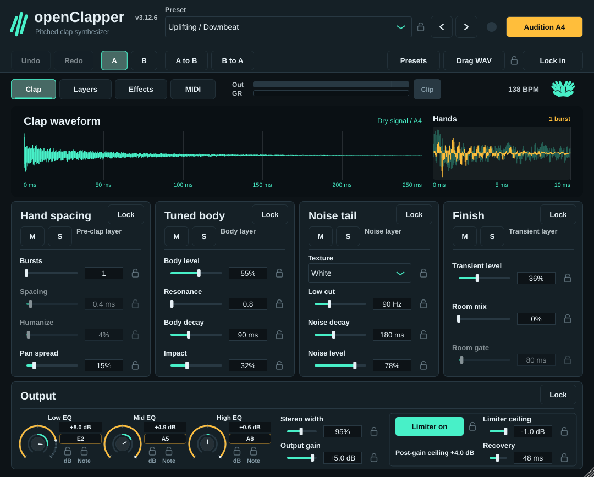
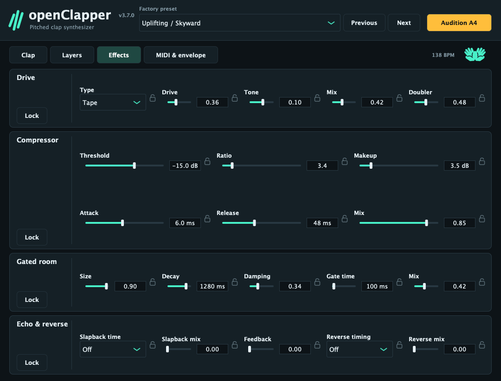

# openClapper v3.11.0

[Install with OpenVST Manager](https://github.com/alanmarcero/alan-m-OpenVSTManager/releases/latest)

## Beta

All of these plugins are in beta. The macOS and Linux builds are not up to date, so the Windows build is the one to use for now. A plugin can change dramatically from one release to the next, but the goal is for each one to keep getting better.

openClapper is a pitched, four-layer clap synthesizer. Play the resonant body from a MIDI keyboard, add a flam of up to five hands, and set how much noise follows the strike. **Audition A4** previews the current sound from any page.

## Choose a clap

The 56 factory sounds span six dance styles: 16 Uplifting and eight each of Rolling, Progressive, Psy, Tech, and Classic. **Previous** and **Next** step through the bank. All factory sounds play as one-shots. They are level-matched, and the limiter is a ceiling above the clap rather than the sound of it.

| Style | Try | Sound |
| --- | --- | --- |
| Uplifting | Downbeat, Euphoria, High Gallery | Massive ensemble claps, chest punch, and long gated stadium tails for uplifting drops. |
| Rolling | Two Hands, Sixteenth, Pocket Drag | Punchy groove claps and rhythmic flams for rolling basslines. |
| Progressive | Cupped Palm, Archway, Booth Air | Warm, sustained claps with full body weight and lush mid-sized rooms. |
| Psy | Fingertips, Tripwire, Five Across | Punchy multi-hand transients and tight yet weighty gated tails for fast psy patterns. |
| Tech | Dry Chalk, Concrete, Mono Print | Solid club hits and wide concrete-gated backbeats. |
| Classic | Paper Fold, Palm Circle, Last Accent | Analog-inspired hand spreads and warm vintage studio rooms. |

The animated hands beside the page tabs meet on each host beat and follow tempo changes and seeks. They rest when playback stops. Standalone and hosts without transport timing use the internal 138 BPM clock.

The **Clap** page shows a dry A4 preview, four-knob cards for **Hand spacing**, **Tuned body** (with **Impact** punch/chest slam), **Noise tail**, and **Finish** (with **Room gate**), and the **Output** section (dual-layer 3-band EQ with ±12 dB gain and note-snapped frequency selection across two octaves per band, stereo width, output gain, and brickwall limiter). Both every section header and every individual control have lock toggles so locked parameters stay put when browsing factory presets. The **Hands** view next to the waveform shows the first 10 ms. The peach trace is the hand bursts, and a tick marks where each one starts. Its caption gives the spacing the bursts play, which is shorter than **Spacing** when the bursts would not fit in 5 ms. **Body decay** and **Noise decay** shape the pitched body and noise tail separately.

The window can be resized, and the last size is saved with the session. **Undo** and **Redo** (also Cmd/Ctrl+Z and Shift+Cmd/Ctrl+Z) step through knob and preset changes. **A** and **B** keep two full setups, with **A to B** and **B to A** to copy between them. **Presets** searches the factory bank and your own sounds, and stars the ones you want to keep handy. Factory sounds stay read-only. Saved sounds go in `Documents/Alan Marcero/openClapper/Presets`. **Drag WAV** pulls the current hit out as a WAV file.

## Shape the layers

On **Layers**, set the timing, decay and stereo placement of the pre-claps. Shape the tuned clap body with its resonance, pitch sweep and filters. Noise has its own attack, hold, decay, curve and stereo width. The transient has its own shape, frequency and decay.

In v3.3, each flam contact takes 0.35 ms to rise, and successive contacts build toward the main strike. Pink noise uses independent left and right filters. Lo-fi noise samples the two channels independently on a shared 12 kHz clock, keeping its texture consistent across host sample rates.

## Play as a synthesizer

Open **MIDI** and select **Hold notes**. The body and noise sustain while the key is down and release when the matching note and channel send note-off. Set attack and decay up to 10 seconds, sustain from 0% to 100%, and release up to 20 seconds. Switch to **One-shot** to use the individual layer decays again. The audition button automatically releases held sounds.

Set the inclusive MIDI key and velocity ranges. Choke group 0 allows overlaps. Groups 1–16 stop older voices in the same group. Audition bypasses the key and velocity ranges. Solo or mute each layer independently. Body, noise, and transient have adjustable velocity response from 0% (constant) through 100% (linear) to 200% (squared). Pre-claps follow velocity.

**Roll & fill** repeats a held note at 1/8, 1/16, 1/32, or 1/16 triplet spacing. Set 1–32 hits. Rolls stop at note-off, transport stop, or seek.

## Add effects and route audio

On **Effects**, adjust drive, compression, gated stereo reverb, dotted-eighth echo, and reverse swell. Output EQ, stereo width, output gain, and limiting live on the **Clap** page under **Output**. Echo follows host tempo and uses 138 BPM if the host supplies none. **Lock in** renders the current hit and plays that recording until you turn it off. In hosts with multi-output support, route the body, noise, transient, and pre-clap to separate stereo buses. Each bus includes its layer controls and master gain, before shared effects and stereo width.

MIDI CC 7 adjusts master level and CC 74 controls noise brightness. CC 120 stops sound and effect tails, CC 121 resets the two controller overrides, and CC 123 releases held notes.

## Changes in 3.5

The Sub Thump, Saturated Tri and Cyber Square body voices are removed. They were stacked sine harmonics, which sounded like a synth tone rather than a clap. The tuned body is now always the resonant band-pass voice, and the **Voice** control is gone. Factory presets that used a removed voice now use the band-pass body. Earlier sessions keep every other setting.

## Changes in 3.11

The editor can be resized and remembers its size. The DAW program list shows all 56 factory claps in the same order as the bank. You can undo edits, compare two setups, save your own presets, and drag the current hit out as a WAV.

## Changes in 3.10

Factory claps have their hand smack back. The 1 kHz body and a little 200–500 Hz weight sit under the bright top, so they read as claps rather than hi-hats. They still hit on the note.

## Changes in 3.9

Factory claps land on the note. Hand spacing and noise attack stop at 5 ms, and older sessions are pulled back to that limit. The bank is bright trance claps: crisp mids and open highs, with no dark or muffled presets.

## Changes in 3.8

- The tuned body is a short strike plus a wide noise color. It no longer keeps a metallic ring through the decay.
- Clicks are filtered noise bursts. Hand spacing, body decay, and noise decay still shape the clap.
- Noise tails fall away smoothly. The room gate closes on a slow curve.
- Drive no longer shifts the waveform off centre.
- Factory claps are level-matched, with the limiter sitting above them.
- Saved sessions keep their parameter values.

## Changes in 3.7

- Added the **Impact** control (`impact_punch`) in **Tuned body** to layer chest slam weight, mid-chest resonator body, and multi-hand crowd saturation without burying crisp transients.
- Extended body decay (`15–1200 ms`), noise hold/decay (`0–90 ms` hold, `20–2200 ms` decay), and gated room tail (`0–1400 ms`), and brought **Room gate** directly onto the **Finish** card on the **Clap** page.
- Re-voiced all 56 factory claps for full stadium and club impact rather than thin, short snaps.

## Formats and compatibility

macOS includes AU, VST3, LV2, and Standalone. Windows and Linux include VST3, LV2, and Standalone. Older sessions restore their saved parameter values and appear as **Custom sound**. The DAW program list shows all 56 factory sounds in the same order as the editor. The original Preset Index automation still covers the first 44 positions, so older sessions keep their values.

MIT License. See [LICENSE](LICENSE).
