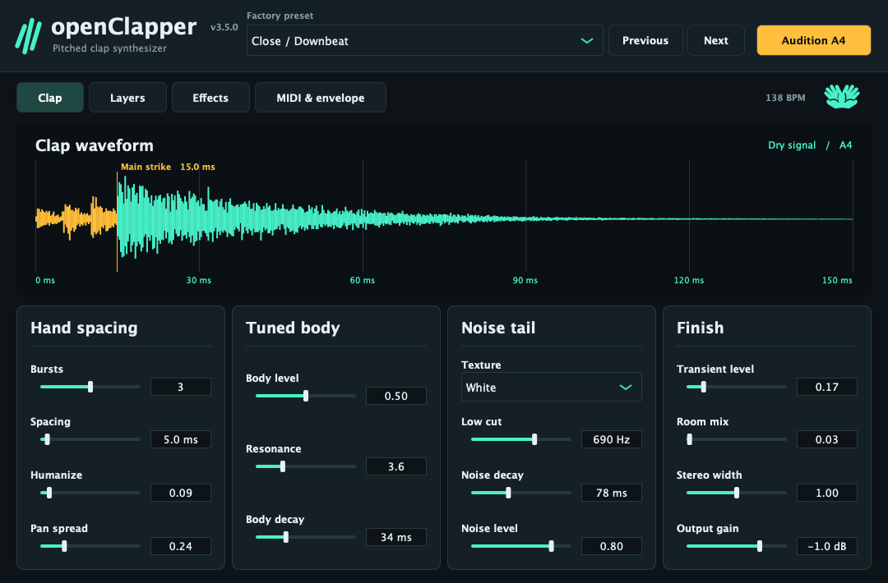
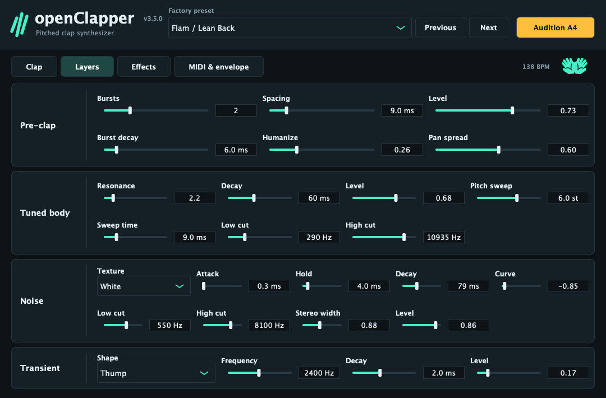
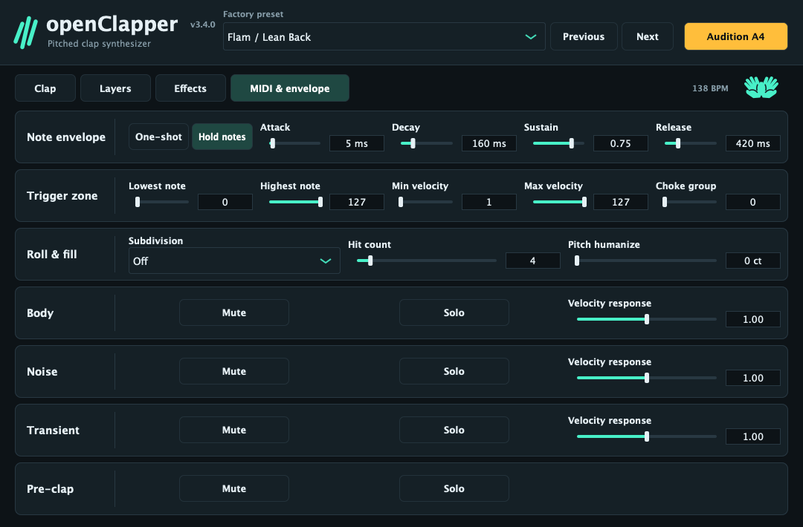

# openClapper v3.2.2

[Install with OpenVST Manager](https://github.com/alanmarcero/alan-m-OpenVSTManager/releases/latest)

## Make pitched trance claps

openClapper creates pitched, layered claps for trance and electronic music. Play from a MIDI keyboard or host. The resonant body follows each note; **AUDITION CLAP** plays A4. Save custom sounds with the project.

## Shape the hit

- **Pre-clap:** Add up to five bursts before the main hit. Set their spread, decay, humanization, pan, and level.
- **Body:** Choose a resonant mode and set its resonance, decay, pitch sweep, filters, and level.
- **Noise:** Choose white, pink, velvet, or lo-fi noise. Set the envelope, filters, stereo width, and level.
- **Transient:** Choose the click type, frequency, decay, and level.
- **Effects:** Add distortion, compression, limiting, gated stereo reverb, host-synced slapback, or a reverse swell. Slapback offers 1/16, dotted 1/16, 1/8, dotted 1/8, and 1/4 notes. It makes one repeat without feedback. If the host does not report tempo, slapback uses 138 BPM.
- **Simple and Advanced views:** Use the main controls in Simple View. Open Advanced View for detailed controls.

The default sound plays as a one-shot. Enable **Full ADSR** to hold a hit with a MIDI note and release it with the matching note and channel. Set attack and decay from 0 to 10 seconds, sustain from 0 to 1, and release from 0 to 20 seconds. The body and noise follow the full envelope. Clicks and pre-claps keep their short sounds.

## Perform with MIDI

The Performance page includes independent velocity response, mute, and solo controls for the body, noise, transient, and pre-clap layers. Set MIDI note and velocity ranges for incoming hits. The ranges include their low and high values. Audition bypasses those ranges. Use choke groups to stop an earlier voice when a new hit arrives. Group 0 allows overlaps; groups 1 through 16 stop earlier voices in the same group.

Set each velocity response to ignore velocity, follow velocity, or square the response. Pre-claps also follow MIDI velocity. Use Roll and Fill to repeat a note at a host-synced rate. Choose off, 1/8, 1/16, 1/32, or 1/16 triplet, and set 1 to 32 hits. The rolls follow host tempo and stop when the note ends, transport stops, or a seek occurs.

The editor can provide separate stereo outputs for the body, noise, transient, and pre-clap. These outputs include the layer controls and master gain, before shared effects and stereo width. Hosts can route them independently from the main mix.

MIDI CC 7 controls the master level. CC 74 controls noise brightness. CC 120 stops sound and effect tails; CC 121 resets CC 7 and CC 74; CC 123 stops held notes.

## Factory presets

Choose from 45 factory presets for gated, wide, rolling, slap, and psytrance claps. Names include Mainstage Anthem Gate, Progressive Glass, Psy Fractal Snap, and Impact Clap. Impact Clap demonstrates the long Full ADSR sound. Programs 1–44 keep their existing host automation assignments.

## Screenshots

## Formats and license

Available as VST3, AU for macOS, LV2, and Standalone on macOS, Windows, and Linux.

MIT License. See [LICENSE](LICENSE).
