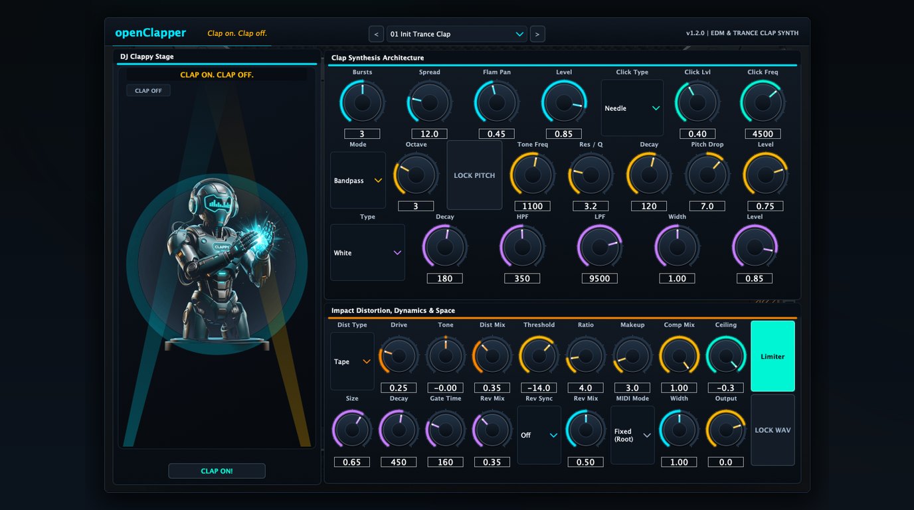
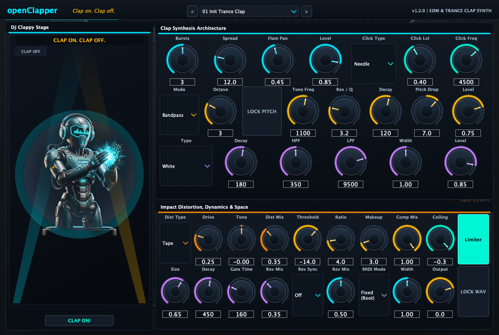

# openClapper

[Install with OpenVST Manager](https://github.com/alanmarcero/alan-m-OpenVSTManager/releases/latest)

Clap on. Clap off.

openClapper is an EDM and trance clap drum synthesizer plugin. It includes multi-burst micro-slap flam with stereo micro-panning, continuous resonant body tuning across 8 octaves with dedicated pitch lock-in across preset browsing, four-texture noise shaping, transient click selection, warm impact saturation, compressor and brickwall limiter dynamics, non-linear gated reverb with allpass diffusion, host-synced reverse swells, session WAV lock-in, and the animated DJ Clappy stage.

Available as VST3, AU, LV2, and Standalone on macOS, Windows, and Linux.





## Sound architecture

### Pre-clap flam

Controls the micro-bursts that precede the main collective slap impact. Pre-burst decay and organic jitter are baked into the spread spacing for tight, mud-free transient definition.

| Parameter | ID | Range | Description |
|---|---|---|---|
| Bursts | `pre_bursts` | 1 to 5 | Number of micro-bursts before the main slap |
| Spread | `pre_spread` | 2.0 to 45.0 ms | Time spacing between bursts |
| Flam Pan | `flam_spread` | 0.0 to 1.0 | Alternating stereo micro-panning width across pre-bursts |
| Level | `pre_level` | 0.0 to 1.0 | Pre-clap output volume |

### Resonant body

Provides the tuned harmonic weight, continuous frequency tuning, and pitch drop of the clap core.

| Parameter | ID | Range | Description |
|---|---|---|---|
| Mode | `tone_mode` | Bandpass, Sub Thump, Saturated Tri, Cyber Square | Tonal generator algorithm |
| Octave | `tone_octave` | 1 to 8 | Octave register (extended with high octaves 6-8) |
| Lock Pitch | `lock_pitch` | On / Off | Locks octave and frequency across presets so tuned pitch stays intact |
| Tone Freq | `tone_freq` | 100 to 6000 Hz | Resonant body center frequency with real-time response |
| Res / Q | `tone_q` | 0.5 to 12.0 | Filter resonance |
| Decay | `tone_decay` | 15 to 600 ms | Body decay envelope |
| Pitch Drop | `tone_pitch_env` | -24 to +24 semitones | Initial pitch dive depth |
| Level | `tone_level` | 0.0 to 1.0 | Tonal body volume |

### Noise and sizzle

Shapes the primary high-frequency noise body and stereo spread. Attack is baked to instantaneous punch and hold is optimized for maximum transient clarity.

| Parameter | ID | Range | Description |
|---|---|---|---|
| Type | `noise_type` | White, Pink, Velvet, Lo-Fi | Noise spectrum source |
| Decay | `noise_decay` | 20 to 1000 ms | Noise decay time |
| HPF | `noise_hpf` | 20 to 2500 Hz | 12 dB/oct high-pass filter cutoff |
| LPF | `noise_lpf` | 800 to 20000 Hz | 12 dB/oct low-pass filter cutoff |
| Width | `noise_stereo_width` | 0.0 to 2.0 | Mid/Side stereo width (0 mono, 1 stereo, 2 wide) |
| Level | `noise_level` | 0.0 to 1.0 | Noise level |

### Transient click

Adds an initial impact needle or crack to define the clap start.

| Parameter | ID | Range | Description |
|---|---|---|---|
| Click Type | `click_type` | Needle, Crack, Thump | Transient generator shape |
| Click Lvl | `click_level` | 0.0 to 1.0 | Level of the initial transient |
| Click Freq | `click_freq` | 1000 to 12000 Hz | Center frequency of the click impulse |

### Impact distortion

Saturates and hardens the clap attack and body.

| Parameter | ID | Range | Description |
|---|---|---|---|
| Dist Type | `dist_type` | Tape, Tube, Hard Clip, Wavefold | Distortion transfer curve |
| Drive | `dist_drive` | 0.0 to 1.0 | Saturation drive (adds up to +28 dB internal gain) |
| Tone | `dist_tone` | -1.0 to +1.0 | Post-distortion tilt filter (-1 dark, +1 bright) |
| Dist Mix | `dist_mix` | 0.0 to 1.0 | Parallel distortion mix |

### Compressor and limiter

Dynamics processing stage for transient control and loudness.

| Parameter | ID | Range | Description |
|---|---|---|---|
| Threshold | `comp_thresh` | -40.0 to 0.0 dB | Compressor threshold |
| Ratio | `comp_ratio` | 1.0:1 to 20.0:1 | Compression ratio |
| Attack | `comp_attack` | 0.1 to 50.0 ms | Compressor attack time |
| Release | `comp_release` | 10 to 500 ms | Compressor release time |
| Makeup | `comp_makeup` | 0.0 to 24.0 dB | Makeup gain |
| Comp Mix | `comp_mix` | 0.0 to 1.0 | Parallel compression blend |
| Ceiling | `limiter_ceiling` | -12.0 to 0.0 dB | Brickwall limiter ceiling |
| Release | `limiter_release` | 5 to 100 ms | Limiter release time |
| Limiter Enabled | `limiter_enabled` | On / Off | Engages the zero-overshoot limiter |

### Gated reverb

Algorithmic diffuser reverb with dual allpass stages and gate cutoff.

| Parameter | ID | Range | Description |
|---|---|---|---|
| Size | `reverb_size` | 0.1 to 1.0 | Room dimension scaling |
| Decay | `reverb_decay` | 50 to 2500 ms | Tail reverberation time |
| Damping | `reverb_damp` | 0.0 to 1.0 | High-frequency damping factor |
| Gate Time | `reverb_gate` | 0 to 600 ms | Gate cutoff time (0 disables gate) |
| Rev Mix | `reverb_mix` | 0.0 to 1.0 | Reverb dry/wet blend |

### Reverse swells and master

| Parameter | ID | Range | Description |
|---|---|---|---|
| Rev Sync | `reverse_mode` | Off, Beat End, Beat 4 Auto, 1/2 Beat, 1/4 Beat | Host tempo sync mode for reverse swell |
| Rev Mix | `reverse_mix` | 0.0 to 1.0 | Level of reverse swell |
| MIDI Mode | `midi_mode` | Fixed (Root), Note Tracking | Fixed pitch or MIDI note pitch tracking |
| Lock In | `lock_in` | On / Off | Bakes rendered clap into session WAV memory |
| Width | `stereo_width` | 0.0 to 2.0 | Master stereo image width |
| Output | `output_gain` | -36.0 to +12.0 dB | Master output volume trim |

## Factory presets

| Index | Name | Style |
|---|---|---|
| 01 | Init Trance Clap | Balanced trance clap with 3-burst flam and gated tail |
| 02 | Uplifting Euphoria | Extended decay with wide stereo sizzle and hall reverb |
| 03 | Psytrance Laser Snap | Fast pitch envelope, high Q resonance, tight gate |
| 04 | Big Room Festival Stomp | Compressed body with tape saturation and sub weight |
| 05 | 138 BPM Peak Time | Fast transient attack tailored for 138 BPM arrangements |
| 06 | Dutch Hardstyle Smacker | Hard clip distortion with boosted mid tone |
| 07 | Progressive Velvet Air | Velvet noise texture with gentle compression |
| 08 | Future Rave Cyber Slap | Wavefolded resonance with bright click needle |
| 09 | 90s Eurodance Gated Classic | 160 ms gated tail reminiscent of early digital reverb units |
| 10 | Vocal Layering Clap | Mid-scooped wide clap designed to leave room for leads |
| 11 | Electro Sizzle Punch | Lo-fi bit-reduced noise with high distortion drive |
| 12 | Tech Trance Acid Bite | Narrow bandpass body with quick release gate |
| 13 | Hands Up German Party | High-pitched flam with room reverb |
| 14 | Stadium Crowd Swarm | 5-burst wide flam simulating group claps |
| 15 | Cyberpunk Neon Slam | Wavefold distortion with wide noise stereo image |
| 16 | Anjunabeats Melodic Dream | Soft tape drive with velvet noise decay |
| 17 | Melbourne Bounce Spank | Fast compressor release for bouncy offbeat grooves |
| 18 | Vocal Chop Pre-Swell | Reverse swell into a dry center hit |
| 19 | Raw Warehouse Techno | Dark filter cutoff with tube saturation |
| 20 | Trance Energy 2000 | Classic early 2000s gated space with high damping |
| 21 | Dual Flam Stereo Split | Two wide micro-bursts with maximum channel separation |
| 22 | Hardcore Punch In Face | Heavy limiter reduction and hard clipping |
| 23 | Sunset Balearic Chill | Pink noise with gentle attack envelope |
| 24 | Goa Psy Resonance Ring | High resonance pitch drop in key |
| 25 | Mainstage Drop Impact | Hard click transient with compressor makeup gain |
| 26 | Minimal Click & Flam | Dry transient without reverb tail |
| 27 | Dirty Dutch Pitch Drop | 24-semitone pitch dive on the body core |
| 28 | Gated Snare-Clap Hybrid | Low 200 Hz body weight layered with noise |
| 29 | Euphoric Whiteout Noise | Broad-spectrum white noise sweep |
| 30 | Cyber Clapper Signature | Default sound with 3-burst flam, body tone, and gated space |
| 31 | Fast Roll 16th Anti-Mud | Short decay envelope optimized for fast 16th-note rolls |
| 32 | Beat 4 Reverse Pickup | Automatically triggers reverse swell on measure beat 4 |

## MIDI implementation

All MIDI channels are received. Incoming MIDI note-on events trigger the voice. Note velocity scales synth volume, body attack, and locked WAV playback. When MIDI mode is set to Note Tracking, the pitch transposes relative to the root note.

| Controller | Function |
|---|---|
| CC 7 | Master output volume |
| CC 74 | Noise low-pass filter cutoff sweep |
| CC 120 / 123 | All sound off / all notes off (silences active voice) |
| CC 121 | Reset all controllers (resets CC 7 and CC 74 to 127) |

## Build

Building requires CMake 3.22 or newer and a C++20 compiler.

```sh
cmake -S . -B build -DCMAKE_BUILD_TYPE=Release
cmake --build build --config Release --parallel
ctest --test-dir build -C Release --output-on-failure
```

## Repository layout

| Path | Contents |
|---|---|
| `Source/Core` | C++20 DSP engine: `ClapSynth`, `Effects`, and `ClapEngine` |
| `Source/Plugin` | JUCE 8 plugin wrappers, UI controls, panels, parameters, presets |
| `Tests` | Catch2 unit test suite |
| `assets` | Faceplate graphics, mascot artwork, and UI screenshots |
| `.github/workflows` | Multi-platform CI workflow for macOS, Windows, and Linux |

## License

MIT License. Copyright (c) 2026 Alan Marcero.
JUCE is dual-licensed under AGPL-3.0 or commercial license.
